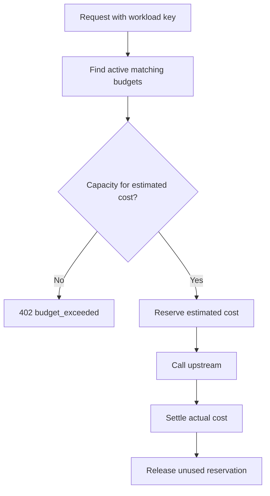
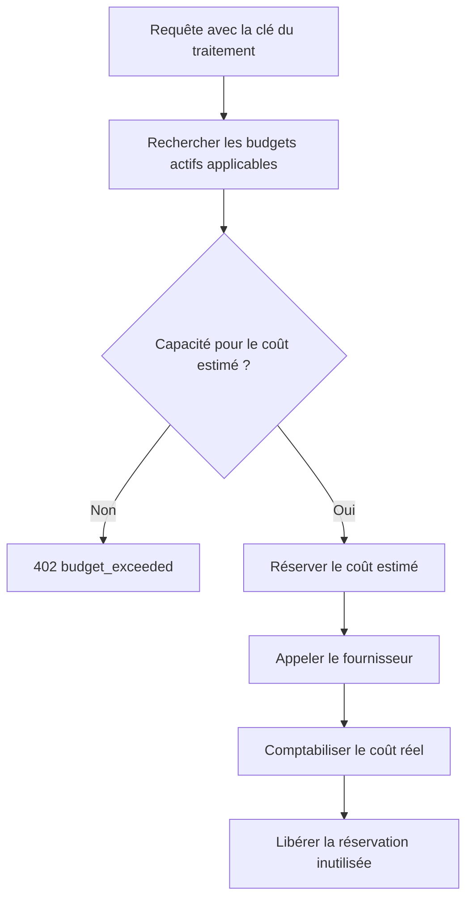

---
{
  "slug": "ai-agency-cost-management-odock",
  "category": "Technical tutorials",
  "title": "AI Agency Cost Management: Set Client Spend Limits with Odock",
  "seoTitle": "AI Agency Cost Management: Set Client Spend Limits",
  "description": "Map client workloads to runtime keys, review Odock budget reservations and recorded spending, and define handling for budget and quota rejections.",
  "excerpt": "Build a client workload register, review matching spending limits, and define how workers respond when budget or quota capacity runs out.",
  "publishedAt": "2026-11-12",
  "updatedAt": "2026-11-12",
  "readingTime": "8 min",
  "keywords": [
    "AI agency cost management",
    "AI agency client cost tracking",
    "LLM spending limits",
    "LLM API budget management",
    "Odock budget reservation"
  ],
  "heroEyebrow": "Client spending controls",
  "intro": "To control client spending, assign a separate runtime key to each workload, associate its intended ceiling with the correct principal, and verify attribution before expanding traffic. Odock reserves estimated cost before the upstream call and settles actual cost after completion. This tutorial provides a workload register, documented budget review steps, and a local rejection-policy example; the supplied evidence does not include the complete budget-creation procedure.",
  "keyTakeaways": [
    "Use a separate key per client workload as a proposed attribution design.",
    "Review broader matching controls alongside each workload's intended ceiling.",
    "Test the worker's pause and escalation behavior before production rollout.",
    "Keep gateway spending review separate from the broader project-margin worksheet."
  ],
  "faq": [
    {
      "question": "Does a team-scoped key automatically grant model access?",
      "answer": "Scope affects attribution and matching controls; it does not grant model or MCP access by itself."
    },
    {
      "question": "Why can a request fail when its key budget has capacity?",
      "answer": "Every active rule matching the request's principal must pass, including broader organization or team controls."
    },
    {
      "question": "Should a worker immediately retry budget exhaustion?",
      "answer": "For budget exhaustion, the documentation recommends pausing work, waiting for capacity, or escalating instead of immediately retrying."
    }
  ],
  "relatedSlugs": [
    "how-to-control-llm-costs-with-virtual-api-keys-budgets-and-quotas",
    "ai-agent-identity-and-non-human-identity-security-in-2026",
    "what-to-log-monitor-and-trace-in-production-llm-apps"
  ],
  "cta": {
    "title": "Review one client workload",
    "description": "Bring your workload mapping, intended spending ceiling, and rejection-handling requirements to a demo.",
    "primaryLabel": "Request a demo",
    "primaryHref": "#waitlist-section",
    "secondaryLabel": "Read the docs",
    "secondaryHref": "https://docs.odock.ai/docs/getting-started/"
  },
  "locales": {
    "fr": {
      "category": "Tutoriels techniques",
      "title": "Agences IA : encadrer les dépenses par client avec Odock",
      "seoTitle": "Agences IA : encadrer les dépenses par client",
      "description": "Associez chaque traitement client à une clé API, vérifiez les réservations de budget Odock et définissez la réponse aux dépassements de budget et de quota.",
      "excerpt": "Préparez un registre des traitements clients, vérifiez les plafonds applicables et définissez le comportement des workers lorsque le budget ou le quota est épuisé.",
      "heroEyebrow": "Contrôle des dépenses par client",
      "intro": "Pour encadrer les dépenses par client, attribuez une clé d’exécution distincte à chaque traitement, rattachez le plafond prévu au bon principal et vérifiez l’attribution avant d’augmenter le trafic. Odock réserve le coût estimé avant l’appel au fournisseur et comptabilise le coût réel une fois l’appel terminé. Ce tutoriel propose un registre des traitements, des étapes documentées de vérification des budgets et un exemple local de gestion des rejets. Les éléments fournis ne comprennent pas la procédure complète de création d’un budget.",
      "keyTakeaways": [
        "Prévoyez une clé distincte par traitement client pour organiser l’attribution des dépenses.",
        "Vérifiez les contrôles de portée plus large en complément du plafond prévu pour chaque traitement.",
        "Testez la mise en pause du worker et la remontée au responsable avant le déploiement en production.",
        "Séparez le suivi des dépenses dans la passerelle du tableau global de marge par projet."
      ],
      "cta": {
        "title": "Examinez un traitement client",
        "description": "Préparez votre correspondance entre traitements et clés, le plafond de dépenses prévu et vos exigences de gestion des rejets pour une démo.",
        "primaryLabel": "Demander une démo",
        "secondaryLabel": "Lire la documentation"
      },
      "readingTime": "10 min",
      "keywords": [
        "suivi des dépenses IA par client",
        "plafond de dépenses API IA",
        "rentabilité des projets d’agence IA",
        "maîtriser les coûts des modèles de langage",
        "gestion du budget API"
      ],
      "faq": [
        {
          "question": "Une clé rattachée à une équipe donne-t-elle automatiquement accès aux modèles ?",
          "answer": "La portée détermine l’attribution et les contrôles applicables ; elle ne donne pas, à elle seule, accès aux modèles ou à MCP."
        },
        {
          "question": "Pourquoi une requête peut-elle échouer alors que le budget de sa clé reste disponible ?",
          "answer": "Chaque règle active applicable au principal de la requête doit être satisfaite, y compris les contrôles de portée plus large définis pour l’organisation ou l’équipe."
        },
        {
          "question": "Un worker doit-il réessayer immédiatement après l’épuisement du budget ?",
          "answer": "En cas d’épuisement du budget, la documentation recommande de suspendre le traitement, d’attendre une capacité disponible ou de solliciter un responsable plutôt que de réessayer immédiatement."
        }
      ]
    }
  }
}
---
<!-- locale:en -->
## What will you build to control client spending?

Build a client-to-key register, a budget configuration worksheet, and a worker rejection policy. Start with one workload and require evidence of attribution, matching controls, and worker behavior before adding others.

Odock reserves estimated cost before the upstream call and settles actual cost after completion. [Odock, Budgets](https://docs.odock.ai/docs/management/budgets/)

Treat separate keys per workload as your implementation design. Do not assume a built-in client-account hierarchy. Keep the client mapping in your operational register.

Investigate the business premise rather than assuming it: which workloads lack owners, which consumption patterns need ceilings, and which client engagements require additional cost reconciliation?

## What prerequisites and versions should you record?

Prepare the following inputs:

- **Existing integration:** Select one working test workload and its owner.
- **Operator access:** Arrange a review of keys, grants, budgets, Usage Records, and Invoices.
- **Pricing review:** Ask the operator to confirm the model and MCP pricing relevant to the workload.
- **Version record:** Record the deployed gateway release, application revision, and local Python version.
- **Credential placeholders:** Use `$ACME_API_KEY` and `https://gateway.example.com` in deployment notes. Store no secret values in the register.
- **Configuration procedure:** Obtain the release-specific budget-creation instructions before changing limits.

Applications call Odock with virtual API keys; upstream provider keys stay inside Odock. [Odock, Virtual API Keys](https://docs.odock.ai/docs/management/virtual-api-keys/)

The supplied evidence establishes neither a minimum gateway release nor a tested Python version. Local validation was attempted, but the execution environment failed before Python started. The example below is not presented as executed or syntax-checked.

## How should you map client workloads to runtime keys?

### Prepare the workload register

Use this hypothetical register. Replace labels with actual identifiers after provisioning, without recording secret values.

| Client | Workload | Proposed key label | Escalation owner |
| --- | --- | --- | --- |
| Acme | Production assistant | acme-assistant-prod | Client operations |
| Acme | Evaluation batch | acme-evaluation | Evaluation lead |
| Beacon | Production assistant | beacon-assistant-prod | Client operations |

Separate workloads when they require different stop decisions. For a client with several keys, explicitly document which controls should cover the combined workload set. Verify the principal design before treating separate key limits as a combined client ceiling.

### Review scope and access separately

Scope affects attribution and matching controls; it does not grant model or MCP access by itself. [Odock, Scope and principals](https://docs.odock.ai/docs/management/virtual-api-keys/scope-and-principals/)

Ask the operator to confirm the principal chain and explicit grants for each registered key. Continue identity planning with [AI agent identity and non-human identity](/blog/ai-agent-identity-and-non-human-identity-security-in-2026/).

## How should you specify and review a spending ceiling?

### Write the intended configuration

Prepare a worksheet with the intended owner, amount, currency, schedule, timezone, and escalation owner. Label it as a proposed specification until the operator verifies the saved configuration.

Documented schedule fields include Start At, Period, Timezone, End At, Rollover, and Active; periods are daily, weekly, monthly, or quarterly. Rollover is qualified as available when supported. [Odock, Windows and reservations](https://docs.odock.ai/docs/management/budgets/windows-and-reservations/)

Ask the operator to confirm rollover behavior before enabling it. The supplied documentation does not include the complete creation form or an administrative request contract. Do not convert this worksheet into an assumed API payload.

### Inspect every matching window

Every active rule matching the request's principal must pass, including broader organization or team controls. [Odock, Management](https://docs.odock.ai/docs/management/)

Follow the documented review path: identify the failed request's key, open its attached budgets, then open **Budgets** and filter for matching organization, team, user, and API-key budgets. Inspect each active window and compare used plus reserved consumption with its limit. [Odock, Handle budget exceeded](https://docs.odock.ai/docs/management/budgets/budget-exceeded/)

Reserved cost represents capacity held for in-flight or unreconciled requests; used cost represents settled actual usage. The documented normal lifecycle releases unused reservation. [Odock, Windows and reservations](https://docs.odock.ai/docs/management/budgets/windows-and-reservations/)



### Check a hypothetical capacity calculation

For a worksheet exercise, assume a $100 window with $80 used and $15 reserved. That leaves $5 for the illustrative next reservation. A proposed $6 reservation exceeds that remainder.

These are hypothetical inputs, not measured gateway results. Do not use this calculation as evidence that a configured limit works.

When any active matching budget lacks capacity, Odock rejects the request before the upstream call with `402 budget_exceeded`. [Odock, Handle budget exceeded](https://docs.odock.ai/docs/management/budgets/budget-exceeded/)

## How should your worker handle rejected requests?

### Define the stop decision

For budget exhaustion, the documentation recommends pausing work, waiting for capacity, or escalating instead of immediately retrying. [Odock, Handle budget exceeded](https://docs.odock.ai/docs/management/budgets/budget-exceeded/)

When any active matching quota lacks capacity, Odock rejects the request before the upstream call with `429 quota_exceeded`. The documentation recommends slowing down, waiting, stopping a batch, or investigating traffic while avoiding tight retry loops. [Odock, Handle quota exceeded](https://docs.odock.ai/docs/management/quotas/quota-exceeded/)

Save this proposed policy as `client_limits.py`. Pass it an HTTP status and an already normalized error code. Confirm the deployed response-body contract before adding response parsing.

```python
def next_action(status, code):
    if (status, code) == (402, "budget_exceeded"):
        return "pause_and_notify_owner"
    if (status, code) == (429, "quota_exceeded"):
        return "stop_batch_and_review_capacity"
    if 200 <= status < 300:
        return "continue"
    return "handle_other_response"


cases = [
    (200, "", "continue"),
    (402, "budget_exceeded", "pause_and_notify_owner"),
    (429, "quota_exceeded", "stop_batch_and_review_capacity"),
    (500, "", "handle_other_response"),
]

for status, code, expected in cases:
    action = next_action(status, code)
    assert action == expected
    print(f"{status}: {action}")
```

### Run the local checks

Run these commands in your development environment:

```bash
python3 --version
python3 -m py_compile client_limits.py
python3 client_limits.py
```

Expected output from the final command, not observed execution output:

```text
200: continue
402: pause_and_notify_owner
429: stop_batch_and_review_capacity
500: handle_other_response
```

Implement the actual pause, notification, and batch-stop effects in your worker. Test that queued work remains paused and that an owner receives the escalation. The local function only selects action names.

## How do you verify attribution and recorded spending?

### Inspect one controlled request

Use your existing verified integration to send one request within an approved test allowance. Record the workload, key identifier, response status, and available request identifiers.

Usage records include the principal, provider, model, status, latency, request ID, tokens, USD cost, and routing trace. Recording is asynchronous, so records may appear a few seconds after the response. [Odock, Usage Records](https://docs.odock.ai/docs/observability/usage-records/)

Expected review result: the recorded API key and owner chain match the workload register. Investigate mismatches before expanding traffic.

### Review and export the selected period

The Invoices interface reads stored usage, supports period, team, and API-key filters, and exports PDF summaries or detailed CSV records. Missing model or MCP pricing can leave costs incomplete. [Odock, Invoices](https://docs.odock.ai/docs/tools/invoices/)

Open **Invoices**, select the period and registered keys, and review the preview. Choose **Download CSV (all records)** for detailed records. Expected review result: the selected period and keys match the worksheet. [Odock, Invoices](https://docs.odock.ai/docs/tools/invoices/)

MCP calls appear in the shared usage table under `provider = mcp`; their Cost total already includes the MCP-specific contribution. [Odock, MCP usage records](https://docs.odock.ai/docs/observability/usage-records/mcp-usage-records/)

Avoid counting that contribution twice. For project-margin review, maintain a separate worksheet for revenue, delivery labor, hosting, external tools, and support. Do not label the gateway export as your complete profitability report.

### Verify actual enforcement separately

Arrange a controlled exhaustion test with the operator after confirming the creation procedure and test allowance. Require an observed rejection, the expected worker pause, and an escalation record.

Do not treat the local policy assertions as proof of gateway enforcement. Preserve application and gateway evidence for the same test request.

## What should you check when results look wrong?

- **Forbidden model or tool:** Review explicit grants separately from key scope. [Scope and principals](https://docs.odock.ai/docs/management/virtual-api-keys/scope-and-principals/)
- **Unexpected budget rejection:** Inspect every active matching window, including broader controls. [Handle budget exceeded](https://docs.odock.ai/docs/management/budgets/budget-exceeded/)
- **Missing recent record:** Allow for asynchronous persistence, then refresh. [Usage Records](https://docs.odock.ai/docs/observability/usage-records/)
- **Incomplete spending:** Review period filters and configured pricing. [Invoices](https://docs.odock.ai/docs/tools/invoices/)
- **Capacity still reserved:** Review reservations separately from settled usage. [Windows and reservations](https://docs.odock.ai/docs/management/budgets/windows-and-reservations/)

For unexplained settlement after cancellation, failure, or interrupted streaming, preserve request evidence and ask the operator to establish the expected lifecycle. The supplied evidence does not resolve those cases.

## What should you complete before adding another client?

Require a register entry matched to request evidence, verified saved budget settings, a review of all matching windows, an observed worker stop, and a spending export checked for pricing gaps.

Continue with [virtual keys, budgets, and quotas](/blog/how-to-control-llm-costs-with-virtual-api-keys-budgets-and-quotas/) and [production logging and tracing](/blog/what-to-log-monitor-and-trace-in-production-llm-apps/).

## Sources

- Odock, [Virtual API Keys](https://docs.odock.ai/docs/management/virtual-api-keys/), publication date not supplied.
- Odock, [Scope and principals](https://docs.odock.ai/docs/management/virtual-api-keys/scope-and-principals/), publication date not supplied.
- Odock, [Management](https://docs.odock.ai/docs/management/), publication date not supplied.
- Odock, [Budgets](https://docs.odock.ai/docs/management/budgets/), publication date not supplied.
- Odock, [Windows and reservations](https://docs.odock.ai/docs/management/budgets/windows-and-reservations/), publication date not supplied.
- Odock, [Handle budget exceeded](https://docs.odock.ai/docs/management/budgets/budget-exceeded/), publication date not supplied.
- Odock, [Handle quota exceeded](https://docs.odock.ai/docs/management/quotas/quota-exceeded/), publication date not supplied.
- Odock, [Usage Records](https://docs.odock.ai/docs/observability/usage-records/), publication date not supplied.
- Odock, [Invoices](https://docs.odock.ai/docs/tools/invoices/), publication date not supplied.
- Odock, [MCP usage records](https://docs.odock.ai/docs/observability/usage-records/mcp-usage-records/), publication date not supplied.

<!-- locale:fr -->
## Que faut-il préparer pour encadrer les dépenses par client ?

Préparez un registre associant clients et clés, une fiche de configuration des budgets et une politique de gestion des rejets pour les workers. Commencez par un traitement. Avant d’en ajouter d’autres, exigez des preuves de son attribution, des contrôles applicables et du comportement du worker.

Odock réserve le coût estimé avant l’appel au fournisseur et comptabilise le coût réel une fois l’appel terminé. [Odock, Budgets](https://docs.odock.ai/docs/management/budgets/)

L’utilisation d’une clé distincte par traitement relève de votre choix d’implémentation. Ne supposez pas l’existence d’une hiérarchie native de comptes clients. Conservez la correspondance avec les clients dans votre registre opérationnel.

Vérifiez le besoin métier sans le tenir pour acquis : quels traitements n’ont pas de responsable ? Quelles consommations nécessitent un plafond ? Quelles missions clients demandent un rapprochement supplémentaire des coûts ?

## Quels prérequis et quelles versions consigner ?

Préparez les éléments suivants :

- **Intégration existante :** choisissez un traitement de test fonctionnel et identifiez son responsable.
- **Accès opérateur :** prévoyez une revue des clés, des autorisations, des budgets, des Usage Records et des Invoices.
- **Vérification des tarifs :** demandez à l’opérateur de confirmer les tarifs des modèles et de MCP applicables au traitement.
- **Versions :** consignez la version déployée de la passerelle, la révision de l’application et la version locale de Python.
- **Valeurs fictives pour les identifiants :** utilisez `$ACME_API_KEY` et `https://gateway.example.com` dans les notes de déploiement. Ne stockez aucune valeur secrète dans le registre.
- **Procédure de configuration :** obtenez les instructions de création des budgets propres à la version déployée avant de modifier les limites.

Les applications appellent Odock avec des clés API virtuelles ; les clés des fournisseurs en amont restent dans Odock. [Odock, Virtual API Keys](https://docs.odock.ai/docs/management/virtual-api-keys/)

Les éléments fournis n’établissent ni version minimale de la passerelle ni version testée de Python. Une validation locale a été tentée, mais l’environnement d’exécution a échoué avant le démarrage de Python. L’exemple ci-dessous n’est donc présenté ni comme exécuté ni comme vérifié sur le plan syntaxique.

## Comment associer les traitements clients aux clés d’exécution ?

### Préparer le registre des traitements

Utilisez ce registre fictif. Après le provisionnement, remplacez les libellés par les identifiants réels, sans consigner les valeurs secrètes.

| Client | Traitement | Libellé de clé proposé | Responsable à solliciter |
| --- | --- | --- | --- |
| Acme | Assistant en production | acme-assistant-prod | Opérations clients |
| Acme | Lot d’évaluation | acme-evaluation | Responsable des évaluations |
| Beacon | Assistant en production | beacon-assistant-prod | Opérations clients |

Séparez les traitements lorsqu’ils nécessitent des décisions d’arrêt différentes. Pour un client disposant de plusieurs clés, documentez explicitement les contrôles qui doivent couvrir l’ensemble de ses traitements. Vérifiez la structure des principaux avant de considérer les limites de clés distinctes comme un plafond client global.

### Vérifier séparément la portée et les accès

La portée détermine l’attribution et les contrôles applicables ; elle ne donne pas, à elle seule, accès aux modèles ou à MCP. [Odock, Scope and principals](https://docs.odock.ai/docs/management/virtual-api-keys/scope-and-principals/)

Demandez à l’opérateur de confirmer la chaîne des principaux et les autorisations explicites de chaque clé du registre. Poursuivez la préparation des identités avec [l’identité des agents IA et les identités non humaines](/fr/blog/ai-agent-identity-and-non-human-identity-security-in-2026/).

## Comment définir et vérifier un plafond de dépenses API IA ?

### Décrire la configuration souhaitée

Préparez une fiche indiquant le propriétaire prévu, le montant, la devise, le calendrier, le fuseau horaire et le responsable à solliciter. Présentez-la comme une proposition tant que l’opérateur n’a pas vérifié la configuration enregistrée.

Les champs de calendrier documentés comprennent Start At, Period, Timezone, End At, Rollover et Active ; les périodes sont quotidiennes, hebdomadaires, mensuelles ou trimestrielles. Le report Rollover est indiqué comme disponible lorsqu’il est pris en charge. [Odock, Windows and reservations](https://docs.odock.ai/docs/management/budgets/windows-and-reservations/)

Demandez à l’opérateur de confirmer le fonctionnement du report avant de l’activer. La documentation fournie ne comprend ni le formulaire complet de création ni le contrat d’une requête d’administration. N’en déduisez pas un corps de requête API à partir de cette fiche.

### Examiner chaque fenêtre applicable

Chaque règle active applicable au principal de la requête doit être satisfaite, y compris les contrôles de portée plus large définis pour l’organisation ou l’équipe. [Odock, Management](https://docs.odock.ai/docs/management/)

Suivez le parcours de vérification documenté : identifiez la clé de la requête en échec, ouvrez les budgets qui lui sont rattachés, puis ouvrez **Budgets**. Filtrez ensuite les budgets applicables par organisation, équipe, utilisateur et clé API. Examinez chaque fenêtre active et comparez la consommation utilisée, augmentée de la consommation réservée, à sa limite. [Odock, Handle budget exceeded](https://docs.odock.ai/docs/management/budgets/budget-exceeded/)

Le coût réservé représente la capacité retenue pour les requêtes en cours ou non encore rapprochées ; le coût utilisé représente la consommation réelle comptabilisée. Le cycle normal documenté libère la réservation inutilisée. [Odock, Windows and reservations](https://docs.odock.ai/docs/management/budgets/windows-and-reservations/)



### Vérifier un calcul fictif de capacité

Pour un exercice sur la fiche, supposons une fenêtre de $100 avec $80 utilisés et $15 réservés. Il reste $5 pour la prochaine réservation de cet exemple. Une réservation proposée de $6 dépasse ce solde.

Ces valeurs sont fictives, elles ne proviennent pas de mesures de la passerelle. N’utilisez pas ce calcul comme preuve du bon fonctionnement d’une limite configurée.

Lorsqu’un budget actif applicable manque de capacité, Odock rejette la requête avant l’appel au fournisseur avec `402 budget_exceeded`. [Odock, Handle budget exceeded](https://docs.odock.ai/docs/management/budgets/budget-exceeded/)

## Comment le worker doit-il gérer les requêtes rejetées ?

### Définir la décision d’arrêt

En cas d’épuisement du budget, la documentation recommande de suspendre le traitement, d’attendre une capacité disponible ou de solliciter un responsable plutôt que de réessayer immédiatement. [Odock, Handle budget exceeded](https://docs.odock.ai/docs/management/budgets/budget-exceeded/)

Lorsqu’un quota actif applicable manque de capacité, Odock rejette la requête avant l’appel au fournisseur avec `429 quota_exceeded`. La documentation recommande de ralentir, d’attendre, d’arrêter un lot ou d’examiner le trafic, en évitant les boucles de tentatives rapprochées. [Odock, Handle quota exceeded](https://docs.odock.ai/docs/management/quotas/quota-exceeded/)

Enregistrez cette proposition de politique dans `client_limits.py`. Transmettez-lui un statut HTTP et un code d’erreur déjà normalisé. Confirmez le contrat du corps de réponse déployé avant d’ajouter son analyse.

```python
def next_action(status, code):
    if (status, code) == (402, "budget_exceeded"):
        return "pause_and_notify_owner"
    if (status, code) == (429, "quota_exceeded"):
        return "stop_batch_and_review_capacity"
    if 200 <= status < 300:
        return "continue"
    return "handle_other_response"


cases = [
    (200, "", "continue"),
    (402, "budget_exceeded", "pause_and_notify_owner"),
    (429, "quota_exceeded", "stop_batch_and_review_capacity"),
    (500, "", "handle_other_response"),
]

for status, code, expected in cases:
    action = next_action(status, code)
    assert action == expected
    print(f"{status}: {action}")
```

### Exécuter les vérifications locales

Exécutez ces commandes dans votre environnement de développement :

```bash
python3 --version
python3 -m py_compile client_limits.py
python3 client_limits.py
```

Sortie attendue de la dernière commande, et non résultat d’une exécution observée :

```text
200: continue
402: pause_and_notify_owner
429: stop_batch_and_review_capacity
500: handle_other_response
```

Implémentez les effets réels de pause, de notification et d’arrêt du lot dans votre worker. Vérifiez que les tâches en attente restent suspendues et qu’un responsable reçoit l’alerte. La fonction locale sélectionne uniquement des noms d’actions.

## Comment vérifier l’attribution et les dépenses enregistrées ?

### Examiner une requête contrôlée

Utilisez votre intégration existante et vérifiée pour envoyer une requête dans les limites d’une enveloppe de test approuvée. Consignez le traitement, l’identifiant de la clé, le statut de réponse et les identifiants de requête disponibles.

Les enregistrements d’utilisation comprennent le principal, le fournisseur, le modèle, le statut, la latence, l’identifiant de requête, les tokens, le coût en USD et la trace de routage. L’enregistrement est asynchrone : les données peuvent donc apparaître quelques secondes après la réponse. [Odock, Usage Records](https://docs.odock.ai/docs/observability/usage-records/)

Résultat attendu de la vérification : la clé API enregistrée et la chaîne de propriétaires correspondent au registre des traitements. Examinez tout écart avant d’augmenter le trafic.

### Examiner et exporter la période sélectionnée

L’interface Invoices lit les données d’utilisation stockées, propose des filtres par période, équipe et clé API, et exporte des synthèses PDF ou des enregistrements CSV détaillés. L’absence de tarifs pour les modèles ou MCP peut rendre les coûts incomplets. [Odock, Invoices](https://docs.odock.ai/docs/tools/invoices/)

Ouvrez **Invoices**, sélectionnez la période et les clés du registre, puis examinez l’aperçu. Choisissez **Download CSV (all records)** pour obtenir les enregistrements détaillés. Résultat attendu de la vérification : la période et les clés sélectionnées correspondent à la fiche. [Odock, Invoices](https://docs.odock.ai/docs/tools/invoices/)

Les appels MCP apparaissent dans la table d’utilisation commune sous `provider = mcp` ; leur total Cost comprend déjà la contribution propre à MCP. [Odock, MCP usage records](https://docs.odock.ai/docs/observability/usage-records/mcp-usage-records/)

Évitez de compter cette contribution 2 fois. Pour examiner la rentabilité des projets d’agence IA, tenez une fiche distincte regroupant revenus, coûts de main-d’œuvre, hébergement, outils externes et support. Ne présentez pas l’export de la passerelle comme un rapport complet de rentabilité.

### Vérifier séparément l’application effective des limites

Organisez avec l’opérateur un test contrôlé d’épuisement après confirmation de la procédure de création et de l’enveloppe de test. Exigez un rejet observé, la mise en pause attendue du worker et une trace de l’alerte au responsable.

Ne considérez pas les assertions de la politique locale comme une preuve de l’application des limites par la passerelle. Conservez les éléments de l’application et de la passerelle pour la même requête de test.

## Que vérifier lorsque les résultats semblent incorrects ?

- **Modèle ou outil interdit :** vérifiez les autorisations explicites séparément de la portée de la clé. [Scope and principals](https://docs.odock.ai/docs/management/virtual-api-keys/scope-and-principals/)
- **Rejet budgétaire inattendu :** examinez toutes les fenêtres actives applicables, y compris les contrôles de portée plus large. [Handle budget exceeded](https://docs.odock.ai/docs/management/budgets/budget-exceeded/)
- **Enregistrement récent absent :** tenez compte du délai de persistance asynchrone, puis actualisez. [Usage Records](https://docs.odock.ai/docs/observability/usage-records/)
- **Dépenses incomplètes :** vérifiez les filtres de période et les tarifs configurés. [Invoices](https://docs.odock.ai/docs/tools/invoices/)
- **Capacité toujours réservée :** examinez les réservations séparément de l’utilisation comptabilisée. [Windows and reservations](https://docs.odock.ai/docs/management/budgets/windows-and-reservations/)

Si la comptabilisation reste inexpliquée après une annulation, un échec ou une interruption du streaming, conservez les éléments de la requête. Demandez à l’opérateur d’établir le cycle attendu. Les éléments fournis ne permettent pas de trancher ces cas.

## Que faut-il terminer avant d’ajouter un autre client ?

Exigez une entrée de registre correspondant aux éléments de requête, des paramètres budgétaires enregistrés et vérifiés, une revue de toutes les fenêtres applicables et un arrêt observé du worker. Vérifiez également que l’export des dépenses ne présente aucune lacune tarifaire.

Pour poursuivre la gestion du budget API et maîtriser les coûts des modèles de langage, consultez les articles sur [les clés virtuelles, les budgets et les quotas](/fr/blog/how-to-control-llm-costs-with-virtual-api-keys-budgets-and-quotas/) et sur [la journalisation et le traçage en production](/fr/blog/what-to-log-monitor-and-trace-in-production-llm-apps/).

## Sources

- Odock, [Virtual API Keys](https://docs.odock.ai/docs/management/virtual-api-keys/), date de publication non fournie.
- Odock, [Scope and principals](https://docs.odock.ai/docs/management/virtual-api-keys/scope-and-principals/), date de publication non fournie.
- Odock, [Management](https://docs.odock.ai/docs/management/), date de publication non fournie.
- Odock, [Budgets](https://docs.odock.ai/docs/management/budgets/), date de publication non fournie.
- Odock, [Windows and reservations](https://docs.odock.ai/docs/management/budgets/windows-and-reservations/), date de publication non fournie.
- Odock, [Handle budget exceeded](https://docs.odock.ai/docs/management/budgets/budget-exceeded/), date de publication non fournie.
- Odock, [Handle quota exceeded](https://docs.odock.ai/docs/management/quotas/quota-exceeded/), date de publication non fournie.
- Odock, [Usage Records](https://docs.odock.ai/docs/observability/usage-records/), date de publication non fournie.
- Odock, [Invoices](https://docs.odock.ai/docs/tools/invoices/), date de publication non fournie.
- Odock, [MCP usage records](https://docs.odock.ai/docs/observability/usage-records/mcp-usage-records/), date de publication non fournie.
